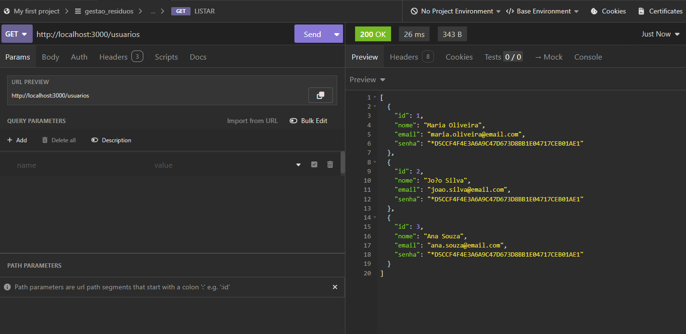
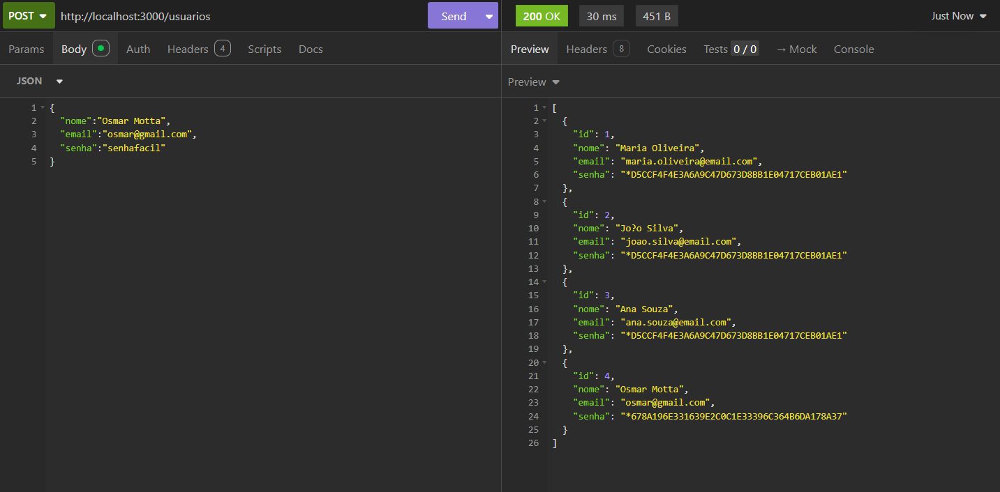
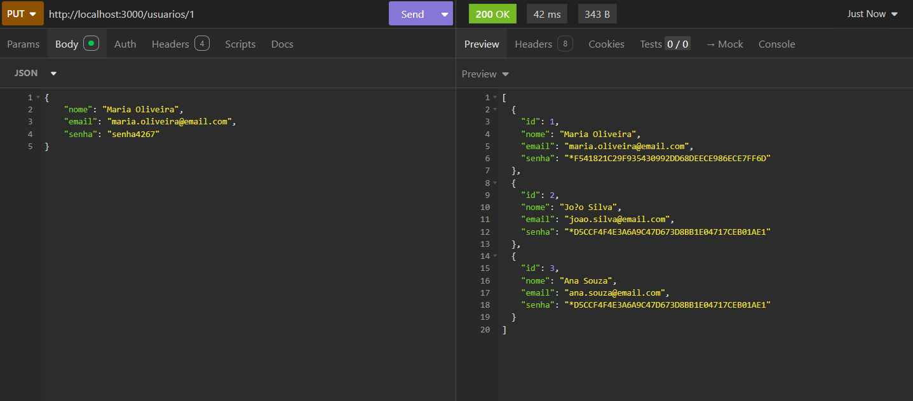
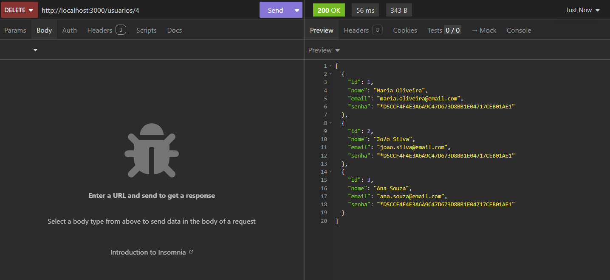
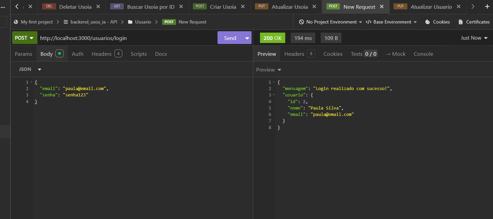
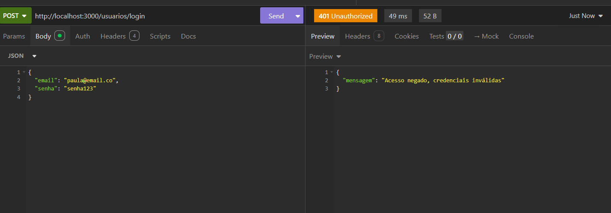
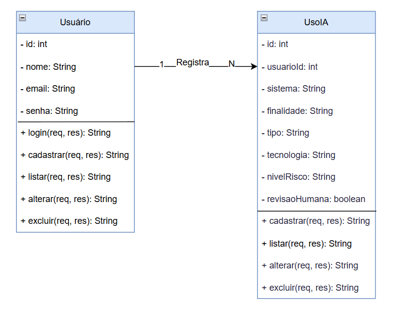
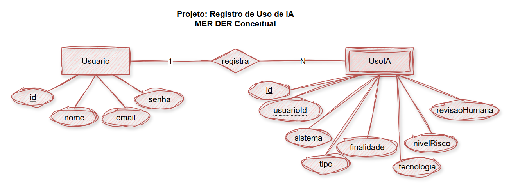

# Aula10 - BackEnd de registros de usos de IA

### Descrição do projeto: <br>
Um pesquisador da Faculdade de Jaguariúna precisa de um banco de dados de registros de usos de Inteligência Artificial.<hr>
- script.sql
```MYSQL
drop database if exists usos_ia;
create database usos_ia;
use usos_ia;
-- DDL Criação das tabelas
create table usuario (
    id int not null auto_increment primary key,
    nome varchar(100) not null,
    email varchar(100) not null unique,
    senha varchar(100) not null
);
create table usoia (
    id int not null auto_increment primary key,
    usuarioId int not null,
    sistema varchar(100) not null,
    tipo enum('Empresa','Escola','Outros') default('Empresa') not null,
    finalidade varchar(100) not null,
    tecnologia varchar(100) not null,
    nivelRisco enum('Baixo','Medio','Alto') default('Baixo') not null,
    revisaoHumana boolean default(true) not null
);
alter table usoia add constraint fk_registra
foreign key (usuarioId) references usuario(id);

-- DML para inserir dados de exemplo nas tabelas
insert into usuario (nome, email, senha) values
('Sofia de Paula', 'maria.oliveira@email.com', password('senha123')),
('Paula Silva', 'paula@email.com', password('senha123')),
('Passos Dias Aguiar', 'passos@email.com', password('senha123'));

insert into usoia(usuarioId, sistema, tipo, finalidade, tecnologia, nivelRisco, revisaoHumana) values
(1, 'Assistente de atendimento', 'Empresa', 'Responder duvidas de clientes', 'IA generativa', 'Baixo', true),
(1, 'Reconhecimento facial', 'Empresa', 'Bater ponto', 'Visao computacional', 'Baixo', true),
(2, 'Biometria', 'Outros', 'Validar identidade', 'Visao computacional', 'Medio', true),
(2, 'Pesquisa de satisfacao', 'Escola', 'Avaliacao do servico de educacao', 'IA generativa', 'Baixo', false),
(3, 'Avaliacao institucional', 'Escola', 'Correcao de gabarito', 'Visao computacional', 'Medio', false);

select * from usuario;
select * from usoia;
show tables;
```

## Método para testar o projeto:
- 1 Clone o repositório
- 2 Abra com VsCode
- 3 Em um teminal CMD ou BASH, digite:
```
npm install
npm run dev
```
- 4 Teste as rotas com a extensão Thunder Client do VsCode ou Insomnia

## Tecnologias:
- VsCode
- Node.js
- JavaScript
- JSON
- Insomnia

## Rotas - usuarios

| Método | Rota | Descrição |
| :--- | :--- | :--- |
| **GET** | `/usuarios/login` | Faz o login do usuário. |
| **GET** | `/usuarios` | Retorna a lista de usuários. |
| **GET** | `/usuarios` | Retorna um usuário específico pelo id. |
| **DELETE** | `/usuario/id` | Remove o usuário referente ao id |
| **POST** | `/usuarios` | Cadastra um novo usuário com auto increment. |
| **PUT** | `/usuarios/id` | Atualiza as informações do usuário pelo id. |

## Rotas - registros

| Método | Rota | Descrição |
| :--- | :--- | :--- |
| **GET** | `/usoia` | Retorna a lista de resíduos. |
| **GET** | `/usoia/resumo` | Retorna a ocorrência específica pela situação. |
| **DELETE** | `/usoia/id` | Remove a ocorrência referente ao id |
| **POST** | `/usoia` | Cadastra uma nova ocorrência com auto increment. |
| **PATCH** | `/usoia/id` | Atualiza as informações da ocorrência pelo id. |

## Exemplos de requisição e testes com o Insomnia

- ### Listar todos os usuários:


- ### Cadastrar um novo usuário:


- ### Atualizar informações de um usuário:


- ### Remover um usuário:


- ### Login realizado com sucesso:


- ### Login negado:


- ### Remover uma ocorrência de resíduo:


## Diagrama de classes e MER DER conceitual:


